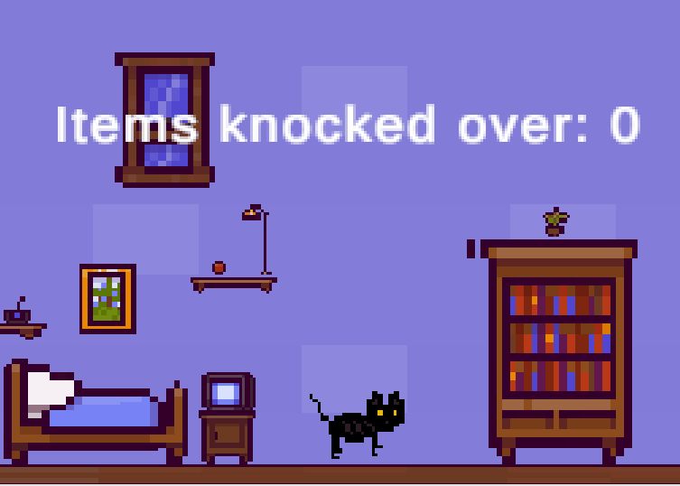

# Cat Platformer

A 2D side-scrolling platformer built solo in an **8-hour game jam** with **Unity 6 and C#**. You play a cat doing what cats do: knocking things over. Every three objects you send flying unlocks the door to the next room.

## How it plays

- Move with **A/D** or the **arrow keys**, and jump with **Space**
- Bump into furniture and household items to tip them over. Hit them harder for a bigger tumble
- An on-screen counter tracks how many items you've knocked over
- Doors open at **3, 6 and 9** knocks, taking you through the house room by room

## How it works

| Script | What it does |
|---|---|
| `CatMovement.cs` | Rigidbody2D movement: horizontal velocity set in `FixedUpdate`, impulse jump, and an Animator state switch for idle / walk-left / walk-right |
| `ObjectTilt.cs` | Applies torque on collision, scaled by the cat's impact speed and direction, so objects topple realistically |
| `KnockedOverItemsCounter.cs` | Counts unique knocked-over objects (a `HashSet` prevents double counting), updates the TextMeshPro counter, and opens each door by disabling its collider once its threshold is reached. Thresholds are set per door in the Inspector |
| `KnockableObject.cs` | Marks an object as knocked over once, on first contact with the cat |

## Art

I drew both cats (the black cat's idle and walk animations, and a calico) and the plate myself in Piskel. The furniture and house tiles come from a free asset pack.

## Running it

Open the project in **Unity 6000.6.0f1** (Unity 6.6) and play `Assets/Scenes/SampleScene.unity`.
